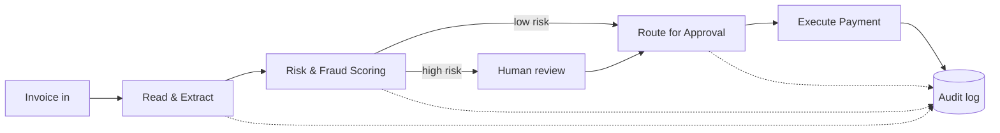

<p align="center">
  <b>AI agents that read invoices, assess risk, route for approval and pay vendors<br>automatically, securely and autonomously.</b>
</p>

<p align="center">
  
  
  
  
</p>

---

## 🔄 How it works

<p align="center">
  
  ">
  
  ">
  
  ">
  
</p>

| Step | Agent | What it does |
|---|---|---|
| 1️⃣ | 🧾 **Read & Extract** | Pulls vendor, amount, date and line items from invoice PDFs / images |
| 2️⃣ | 🛡️ **Risk & Fraud Scoring** | Checks duplicates, vendor history, amount anomalies and mismatches |
| 3️⃣ | 👥 **Route for Approval** | Sends the invoice to the right approver based on amount and risk |
| 4️⃣ | 🏛️ **Execute Payment** | Releases payment only after approval and policy checks pass |



## 🔒 6 governance layers

<p align="center">
  
  
  
  <br>
  
  
  
</p>

| Layer | Purpose |
|---|---|
| 🔐 **Secure Identity & Access** | Each agent and user has its own identity and least-privilege permissions |
| 🗄️ **Protected Data & Privacy** | Sensitive fields are masked, encrypted and access-logged |
| 🧠 **Model Quality & Control** | Extraction and scoring models are evaluated, versioned and monitored |
| 📜 **Policy-Driven Decisions** | Approval limits and payment rules live in editable policy files, not in code |
| 🤖 **Governed Agent Execution** | Agents can only call approved tools; risky actions need human sign-off |
| 👁️ **Observability & Audit Trail** | Every decision is logged with inputs, outputs, model version and approver |

## 📌 Overview

A **learning / demo implementation** of an Accounts Payable (AP) automation system for a bank. Each step of the invoice-to-payment process is handled by an AI agent, and every action is controlled by a governance layer.

> ⚠️ Educational project. It uses synthetic invoices and a sandbox payment step. It is not connected to real bank systems or real money.

## 🧰 Tech stack

> Suggested stack. Edit to match what you actually use.


## 📂 Project structure

```text
ap-ai-agent-system/
├── agents/
│   ├── extract_agent.py   # read & extract invoices
│   ├── risk_agent.py      # risk & fraud scoring
│   ├── approval_agent.py  # route for approval
│   └── payment_agent.py   # execute payments (sandbox)
├── governance/
│   ├── policies.yaml      # approval limits and payment rules
│   ├── access.py          # identity & permissions
│   └── audit_log.py       # audit trail
├── data/
│   └── sample_invoices/   # synthetic invoices only
├── dashboards/            # Power BI / reporting files
├── tests/
├── requirements.txt
└── README.md
```

## 🚀 Getting started

```bash
git clone https://github.com/manusonagara15-ctrl/ap-ai-agent-system.git
cd ap-ai-agent-system
pip install -r requirements.txt
python main.py --input data/sample_invoices
```

## 🗺️ Roadmap

- [x] Project design and governance layers
- [ ] Invoice extraction agent
- [ ] Risk and fraud scoring
- [ ] Approval routing with policy file
- [ ] Sandbox payment execution
- [ ] Audit dashboard in Power BI
- [ ] Evaluation report for extraction and risk models

## 👩‍💻 Author

**Maheshvaree Sonagara**, MSc Data Science student, Marwadi University

[](https://github.com/manusonagara15-ctrl)


